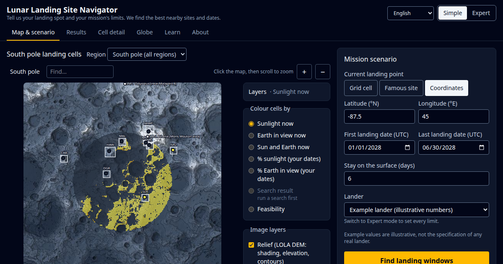

# Lunar Landing Site Navigator — Window Finder

> Tell us your landing spot and your mission's limits. We find the best nearby sites and dates, ranked hour by hour.

**Live demo:** https://lunar-navigator-six.vercel.app · **Challenge:** [NASA Space Apps Challenge 2026 — Lunar Landing Site Navigator](https://www.spaceappschallenge.org/2026/challenges/lunar-landing-site-navigator/)



At the lunar south pole the Sun skims the horizon, so a ridge one degree high can hide it for days, and the Earth (the only direct radio link home) rises and sets on its own schedule. A landing site that is perfect on Monday can leave a lander dark and silent if the launch slips by a week. Window Finder lets a mission planner, a teacher or anyone curious pick a landing point, set the mission's limits, and see, for every nearby cell and every landing time, whether the lander keeps power and contact. It also shows how long until the next sunset and Earthset.

Everything runs in the browser on precomputed NASA terrain data, with no server and no login.

## Features

- **South-pole map:** 2D map of the 9 Artemis III candidate regions.
  - Each region is split into the official USGS Lunar Grid Reference System (LGRS) 1 km cells. A 2 km grid covers the rest of the cap from 80°S to the pole.
  - Cells are coloured by slope, permanent shadow, Sun or Earth visibility, distance to the nearest cold trap, or the search result.
  - Layers: hillshade, multi-zoom relief tiles with contours, and NASA overlays.
  - A lazy-loaded 3D terrain view lit by the real Sun.
- **Mission scenario:** landing point (cell, famous site or typed coordinates), date range, stay length, longest allowed darkness and comm loss, solar panel, battery and load.
  - Presets for VIPER, Nova-C, Blue Ghost 1 and Vikram, with sources and every number marked as published or estimated.
  - An optional AI assistant fills the form from a plain-language description.
- **Window search:** a Web Worker tests every cell in the scope at every landing time, in 6-hour steps. It simulates the Sun, the Earth and the battery hour by hour.
  - Drag or play the landing-time slider: the map turns green, amber or red, and the top-10 table updates at once.
  - A headline says how far your landing can slip, or when the next window opens and which nearby cell works now.
  - "Best windows" lists, for each cell, the longest run of passing landing times.
- **Cell detail:**
  - horizon view with the Sun and Earth paths;
  - a large countdown to sunset and Earthset;
  - Sun elevation;
  - battery chart;
  - side-by-side comparison of two horizons, with one sentence explaining the difference;
  - seasonal calendar;
  - CSV export.
- **Mission Replay:** IM-1, IM-2 and Chandrayaan-3 replayed on their real landing dates. The app predicts sunset at each site, and you can compare it with when each mission actually ended.
- **Validation in view:** a badge links to the comparison with NASA PGDA 69 and JPL Horizons, and the About page shows the scatter plot.
- **Globe and Learn mode:**
  - a 3D Moon showing the day/night line and the sites;
  - short lessons that use your own search results.
- **Shareable:** the whole scenario lives in the URL.
- **Languages and devices:**
  - 7 interface languages: English, Vietnamese, German, Russian, Korean, Japanese and Spanish;
  - works on laptops and phones.

## How it works

```
[Python, run once]                                         [Browser, static site]
 JPL Horizons ─────────── D1 ─> ephemeris.json (hourly sub-solar / sub-Earth points, 2027-01 → 2029-01)
 USGS LGRS 1 km grid ──── D2 ─┐                               C0 geometry (one vector formula)
 PGDA 90 slope + shadow ─ D3 ─┼─ D5 ─> cells_<region>.json    C1 sunlight   C2 Earth contact
 PGDA 90 LOLA DEM ─────── D4 ─┘        regions.json, sites    C3 energy     C4 battery
 PGDA 90 DEM (2 km cap) ─ D9 ─> cap/*.json                    C5 search + ranking (Web Worker)
 PGDA 69 visibility ───── D7 ─> validation.json               React UI: map, form, results,
 PGDA 90 hillshade/DEM ── D8, D8b, D10 ─> maps, relief, 3D    detail, globe, learn, about
```

1. **Terrain horizon:** for each cell, 360 rays are traced through the LOLA 80 m and 240 m digital elevation models, out to 150 km. The angle of each sample is `atan2(h − h_cell − mast − d²/2R, d)`, so the curvature of the Moon is included. The Moon has no atmosphere, so there is no refraction.
2. **Sun and Earth position:** the azimuth and elevation at any point come from the hourly sub-solar and sub-Earth points with a single vector formula, so arbitrary coordinates work without calling Horizons per cell.
3. **Visibility:** a body counts as visible when at least half of its disc is above the terrain horizon. The disc radius is 0.27° for the Sun and 0.95° for the Earth.
4. **Power and battery:**
   - Panel output = `(1 AU / D)² × visible fraction × panel factor`. The panel factor is `cos(el)` for vertical panels and `sin(el)` for horizontal ones; above 60° latitude the app assumes vertical panels.
   - The battery starts full and is updated every hour with input minus load.
5. **Pass, marginal or fail:** a landing window passes when all three limits hold:
   - the longest dark period is within the limit;
   - the longest Earth outage is within the limit;
   - the battery never runs out.

   A passing window is *marginal* when the battery drops below 20 %. Results are ranked by these rules in order, with no weighted score:
   - passing windows first;
   - then the higher minimum battery;
   - then more hours with both Sun and Earth;
   - then the shorter distance;
   - then the shorter Earth outage.

The full contracts for every module are in [docs/technical-reference.md](docs/technical-reference.md).

## Validation

| Check | Result |
|---|---|
| Sun and Earth azimuth and elevation vs. JPL Horizons topocentric ephemeris (30 points) | max error 0.015° azimuth, 0.010° elevation |
| Fraction of time the Sun is visible vs. NASA PGDA 69 (240 cells in 8 regions) | Pearson r = 0.983, RMSE 2.8 percentage points |
| Fraction of time the Earth is visible vs. NASA PGDA 69 (same 240 cells) | Pearson r = 0.986, RMSE 5.7 percentage points |
| Mission Replay: predicted local sunset vs. actual end of mission | Chandrayaan-3's Vikram went to sleep 4 h before the predicted sunset. IM-1 and IM-2 ended days earlier for non-geometric reasons (IM-1 went into standby; IM-2 landed on its side in a crater) |

## Data

All science data comes from public NASA and USGS sources. Nothing is invented: sites without a sourced coordinate are left out.

| Source | Used for |
|---|---|
| [JPL Horizons API](https://ssd.jpl.nasa.gov/api/horizons.api) | Hourly Sun and Earth geometry from January 2027 to January 2029, short ephemerides for Mission Replay, validation points, DSN station elevations |
| [NASA GSFC PGDA product 90](https://pgda.gsfc.nasa.gov/products/90) (LOLA) | 80 m and 240 m south-polar DEMs, slope, permanent shadow (20 m), hillshade |
| [NASA GSFC PGDA product 69](https://pgda.gsfc.nasa.gov/products/69) | Average Sun and Earth visibility, for validation and map overlays |
| [USGS LGRS grids (McClernan 2024)](https://doi.org/10.5066/P1MEQ6UK) | 1 km Artemis Condensed Coordinate cells of the 9 Artemis III regions |
| [NASA SVS 4720](https://svs.gsfc.nasa.gov/4720) | Moon colour and elevation textures for the globe |
| NASA NSSDCA, NASA, ISRO, Intuitive Machines, Firefly | Landed-mission coordinates and dates, lander power figures |
| [NASA/JPL DSN handbook 810-005](https://deepspace.jpl.nasa.gov/dsndocs/810-005/301/301K.pdf) | Optional Deep Space Network visibility check |

Every file, URL and processing step is listed in [DATA_SOURCES.md](DATA_SOURCES.md), and every citation in [REFERENCES.md](REFERENCES.md).

## Tech stack

| Part | Tools |
|---|---|
| Data pipeline | Python 3.11+, NumPy, rasterio, pyproj, GeoPandas, shapely, Pillow, requests |
| Web app | Vite, React 19 (plain JavaScript), Tailwind CSS, Web Workers |
| Maps and charts | SVG + d3-zoom, Apache ECharts, globe.gl, three.js |
| Tests | `node --test` for the browser core, pytest and `pipeline/check_web_data.py` for the data |
| Hosting | Vercel (static site, plus one optional serverless function for the AI assistant) |

## Getting started

**Web app** (Node 20.19 or newer). All data is already in `web/public/data/`, so no Python is needed:

```bash
cd web
npm install
npm run dev          # http://localhost:5173
npm test             # browser-core tests
npm run lint && npm run build
```

**Data pipeline** (optional; only to rebuild the data, about 920 MB of NASA rasters):

```bash
python -m venv .venv && source .venv/bin/activate
pip install -r pipeline/requirements.txt
python pipeline/download_data.py      # PGDA rasters into pipeline/raw/ (gitignored)
python pipeline/check_web_data.py     # checks web/public/data against the data contract
python -m pytest -q pipeline
```

The USGS LGRS shapefiles must be downloaded in a browser, because ScienceBase blocks scripts; see D2 in the [technical reference](docs/technical-reference.md#d2-lgrs-grid). Intermediate results are committed in `pipeline/out/`, so most steps can be rerun without the raw data.

**Optional AI assistant:** the chat that fills the form is off unless the build sets `VITE_CHAT_UI=true` and the server has its Gemini and Upstash keys. See [docs/mission-chat-setup.md](docs/mission-chat-setup.md). The science never depends on it.

## Project structure

```
pipeline/            Python data pipeline (D1–D10), checks and tests
  out/               committed intermediate results
web/
  src/core/          pure JavaScript science core (geometry, sunlight, contact, energy, search) + tests
  src/components/    React UI, one component per file
  src/i18n/          translations (7 languages)
  public/data/       precomputed data served to the browser (cells, cap grid, ephemeris, replay, validation)
  public/maps/       map overlays and relief tiles
  api/, server/      optional AI-assistant serverless function
docs/                technical reference, product design, extra modules, chat setup
```

## Known limitations

- The data has an hourly step. Countdowns are interpolated, so they can be off by a few minutes up to about an hour.
- Horizons are computed at the centre of each 1 km or 2 km cell from 80 m and 240 m elevation models. Boulders and small ridges are not resolved.
- Terrain horizons exist only for grid cells and for sites at or south of 60°S. Other points use a smooth-sphere horizon, and the app says so.
- The battery model is simple: constant load, with no temperature or ageing effects.
- The lander presets are approximate values from public documents, for comparing scenarios only.
- Distance to the nearest permanent shadow uses the PGDA 90 mask resampled to 100 m, which gives 2,007 shadows of at least 1 km² against the 1,531 in the PGDA 90 table. Cells within about 20 km of 80°S may show distances that are too large.
- Mission Replay compares geometry only. It is not a proof of what ended each mission.
- This is not an official NASA tool.

## Team

Built in 48 hours for the NASA Space Apps Challenge 2026 by a team of five:

- **trankhan123:** web app, maps and data pipeline (LGRS grid, feasibility, map layers, cap grid), integration and deployment
- **Quoc_Bao:** sunlight model and terrain horizons
- **chubin271-blip:** Earth contact, famous sites, validation, DSN check and mission chat
- **vominhuy28:** search, ranking and explanations, translations
- **hoanggbach:** energy need, battery charging and scenario validation

## AI disclosure and acknowledgements

AI coding assistants (Claude Code, OpenAI Codex) were used under the team's direction. Every use is listed in [AI_USAGE.md](AI_USAGE.md). Scientific values come only from the cited datasets, and all tests use synthetic values that are marked as such.

Thanks to NASA GSFC (PGDA, LOLA, SVS), NASA/JPL (Horizons, DSN), the USGS Astrogeology Science Center (LGRS) and the NASA Space Apps organisers.
